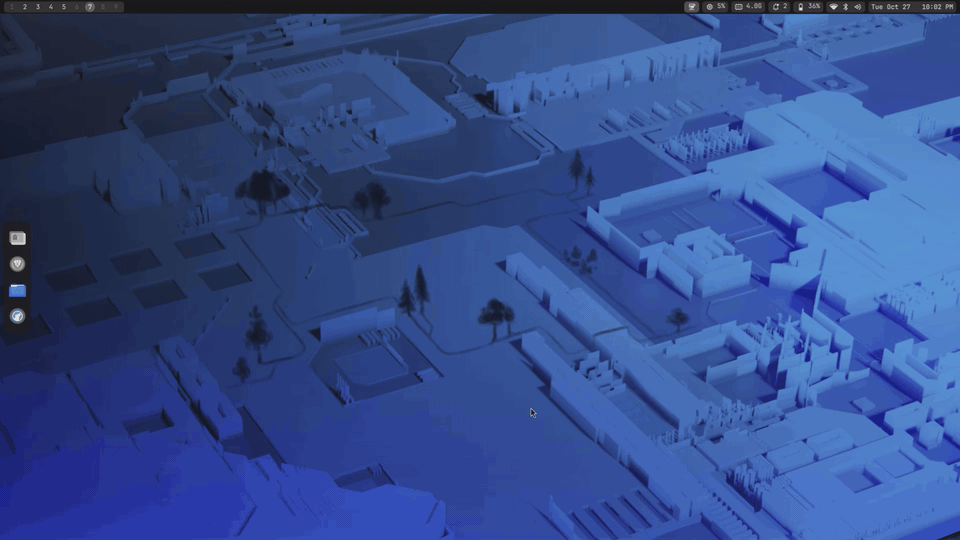

# Vayu Linux


**Vayu Linux** is a Linux distribution based on Fedora. It keeps Fedora's packages, repos, kernels and
updates, and adds its own desktop and identity on top: **MangoWM** (a Wayland compositor) with a
**hand-written Quickshell shell**, a dock with app pinning, a custom login screen, a uniform monochrome
theme with JetBrains Mono everywhere, its own name, logo and boot splash, and tuned power and memory settings.

Vayu (वायु) is the Sanskrit name of the wind.



<sub>Shown with Fedora 44's default wallpaper (CC BY-SA 4.0, Fedora Design Team). The theme colors are generated from whatever wallpaper you pick.</sub>

## How Vayu Linux relates to Fedora

Vayu Linux is a **Fedora derivative**: not a fork that rebuilds Fedora's packages, but a layer on top of a
regular Fedora install. You install Fedora Everything with no desktop, then the installer turns it into
Vayu Linux. What that layer changes:

| Area | What Vayu Linux does |
|---|---|
| **Desktop** | MangoWM, our own Quickshell shell and dock, our own login screen (greetd), matugen theming |
| **Name** | `/etc/os-release` says **Vayu Linux 44** (`NAME`, `PRETTY_NAME`, logo, color), written from Fedora's own file by [`vayu-os-release`](setup/root/usr/local/bin/vayu-os-release) at install, at every boot and before each new kernel gets its boot entry, so a Fedora update or release upgrade that restores the original file doesn't undo it. `ID=fedora` stays, so dnf, repos and scripts that check for Fedora keep working. A default hostname (`fedora`) becomes `vayu`. |
| **Boot** | A Plymouth boot splash with the Vayu logo (`setup/root/usr/share/plymouth/themes/vayu`), Fedora's spinner animation below it; boot menu entries are named Vayu Linux. systemd-boot where it's safe (see Install). |
| **Logo** | [`vayu.svg`](setup/home/.config/fastfetch/vayu.svg), shown by fastfetch and used for the OS icon (`vayu-logo-icon`) |
| **System** | Power profiles that follow the charger, the `scx_lavd` scheduler, zstd-compressed zram swap |
| **Packages** | Extra repos (RPM Fusion, terra, Quickshell COPR, Brave, LibreWolf) and the package list in `setup/packages.txt` |

Everything else (kernel, system libraries, security updates, release upgrades) comes straight from Fedora.
Vayu Linux is an independent project and is not affiliated with or endorsed by the Fedora Project.

## Install

Vayu Linux installs from the **Fedora Everything ISO**:

1. Download the [Fedora Everything ISO](https://fedoraproject.org/misc/#everything)
   and boot it.
2. In the installer's **Software Selection**, pick **Minimal Install** (no desktop environment), and
   create your user account.
3. After the install, log in as your user and run:

   ```bash
   curl -fsSL https://raw.githubusercontent.com/mbodigi/vayu-linux/main/get.sh | bash
   ```

4. Reboot, pick the **Mango** session on the new login screen, and log in.

- It asks for your **password once** (sudo) and downloads about **2.5 GB** of packages, plus the Iotas notes app and its GNOME runtime from Flathub.
- Fedora Workstation, KDE and other editions or spins (anything with a desktop already) aren't
  supported: start from Everything with no desktop.
- **Bootloader:** where it's safe (UEFI, Secure Boot off, no Windows on the disk) it switches to
  **systemd-boot**, like the original machine, and keeps GRUB as a fallback entry in your PC's boot
  menu. Otherwise GRUB stays, with a message saying why. `… | SDBOOT=0 bash` keeps GRUB.
- Want to read it first? `get.sh` just downloads this repo and runs [`install.sh`](install.sh),
  which is short. Or clone the repo and run `./install.sh` yourself.
- A specific version: `curl -fsSL …/get.sh | REF=<tag or branch> bash`.

### What the installer does

1. Adds the repos: RPM Fusion free/nonfree, terra (MangoWM, Ghostty, VSCodium), the official
   [Quickshell COPR](https://copr.fedorainfracloud.org/coprs/errornointernet/quickshell), Brave and LibreWolf.
2. Swaps Fedora's `ffmpeg-free` for RPM Fusion's full `ffmpeg`, then installs the package list
   from [`setup/packages.txt`](setup/packages.txt). Skipped: the original machine's Fedora release package, kernels
   (Fedora's own are used) and installer leftovers.
3. Switches to systemd-boot where it's safe (see above): sdubby in place of grubby, `bootctl install`,
   kernels as boot entries on the EFI partition (without the rescue image, which doesn't fit there).
4. Copies the system files from `setup/root` as root, without changing existing folders like `/` or `/etc`:
   the login screen, browser policies, LibreWolf defaults, battery rule, tuned profile, helper scripts.
   Then applies the Vayu Linux name, logo and boot splash (see above).
5. Creates the `greeter` account the login screen runs as, enables greetd, and enables `scx_loader` (the
   `scx_lavd` CPU scheduler, see [Performance and power](#performance-and-power)).
6. Gives your user the configs from `setup/home` (existing files of yours are kept, not overwritten).
7. At your first login, `shell-firstlogin` applies the settings that live in dconf (GTK theme, icons, fonts, Celluloid).

No wallpapers are included (they're other people's art); pick one with `Super + Y`. The dashboard can
search and download from wallhaven, into the hidden `~/.local/share/wallpapers/`.

## What you get

| Part | What it is |
|---|---|
| **Window manager** | [MangoWM](https://github.com/mangowm/mango) 0.18 (from the terra repo), tiling + floating, scenefx effects |
| **Shell** | Our own [Quickshell](https://quickshell.org) shell (`setup/home/.config/quickshell/shell`): bar, app launcher, clipboard history, notifications + center, control center (with a sound output/input drop-down), OSD, lock screen, dashboard with wallpapers, power menu, cheatsheet, task manager, settings panel, polkit password dialog, battery warnings, Wi-Fi login (captive portal) notification |
| **Dock** | Part of the shell (`dock/`): left edge, intelligent auto-hide, one icon per app with a running indicator. Click focuses / minimizes / restores, middle click closes, **right click → Pin to dock / Unpin, New window, Close** |
| **Login screen** | A Quickshell greeter run by greetd (`setup/root/usr/local/share/shell-greeter`) |
| **Theme** | Colors generated from the wallpaper by matugen (monochrome scheme), applied to the shell, GTK 3/4, Qt 5/6 and Mango; accents are fixed soft grays (#505050 / #8a8a8a) |
| **Fonts** | JetBrains Mono for the UI, monospace and subtitles (fontconfig maps sans-serif to it too) |
| **Browsers** | LibreWolf (default browser, follows the GTK theme, hardware video decoding, compact UI); Brave for web apps, with a policy file that turns off rewards, wallet, VPN, AI, news, telemetry and promos |
| **Notes** | [Iotas](https://flathub.org/apps/org.gnome.World.Iotas) from Flathub: opens to your note list, categories, Markdown with checkboxes. No network access, so notes never leave the machine (no Nextcloud sync) |
| **Video** | Celluloid + mpv with Intel VA-API hardware decoding, full ffmpeg from RPM Fusion |
| **Laptop** | tuned with a custom `laptop-battery` profile; ThinkPad battery charge kept between 75 and 80% (udev rule; harmless on other machines) |

### Performance and power

Vayu Linux switches between two setups by itself, depending on whether the charger is plugged in:

| | On the charger | On battery |
|---|---|---|
| **Power profile** (tuned) | `throughput-performance`: the CPU runs at full speed | `laptop-battery`: powersave governor, balanced energy preference, USB autosuspend and device power management; the CPU still speeds up when there's work |
| **CPU scheduler** | `scx_lavd` in performance mode | `scx_lavd` in power-saving mode, with core compaction (work packed onto fewer cores so the rest can sleep) |

- **The scheduler:** [`scx_lavd`](https://github.com/sched-ext/scx) is a sched_ext scheduler (the kernel's
  plug-in CPU scheduler feature) that gives priority to latency-critical tasks, the ones you're interacting
  with, so the desktop stays responsive under load. It was originally built for gaming on the Steam Deck.
  `scx_loader` starts it at boot with `--autopower`, so it follows the power profile above
  ([`setup/root/etc/scx_loader/config.toml`](setup/root/etc/scx_loader/config.toml)). If it ever stops, the
  kernel falls back to its normal scheduler.
- **The switch:** `tuned-ppd` watches the charger and picks the profile
  ([`setup/root/etc/tuned/ppd.conf`](setup/root/etc/tuned/ppd.conf)).
- **Memory:** compressed swap in RAM (zram, up to 8 GB) with zstd instead of Fedora's lzo-rle, which fits
  about 3:1 instead of 2:1 before anything has to wait.

The full package list is in [`setup/packages.txt`](setup/packages.txt) (about 1,800 packages; a few machine-specific ones are skipped on install).

### Keyboard shortcuts (the most used ones)

| Keys | Action |
|---|---|
| `Super + Enter` | Terminal (Ghostty) |
| `Super + Space` | App launcher |
| `Super + V` | Clipboard history |
| `Super + D` | Dashboard |
| `Super + Y` | Wallpapers |
| `Super + A` | Control center (Wi-Fi, audio, brightness…) |
| `Super + ,` | Settings |
| `Super + X` | Power menu |
| `Super + Alt + L` | Lock screen |
| `Super + Shift + /` | Cheatsheet with every shortcut |
| `Super + Q` | Close window |
| `Super + F` / `Super + Shift + F` | Maximize / fullscreen |
| `Super + Shift + Space` | Toggle floating |
| `Super + O` | Overview |
| `Alt + Tab` | Cycle windows |
| `Print` / `Ctrl + Print` / `Alt + Print` | Screenshot region / full screen / window |
| `Ctrl + Alt + Delete` | Task manager |
| `Super + Shift + P` | Pin / unpin the focused app to the dock |


## Keeping the repo up to date (on the original machine)

After changing anything on the desktop:

```bash
./collect.sh      # snapshot the current setup into setup/ (read-only on the system)
git diff          # review what changed
git commit -am "Update setup" && git push
```

`collect.sh` only reads from the system. It copies the configs into `setup/`, rewrites the home
folder path as `@HOME@`, moves helper scripts to `/usr/local/bin`, records every installed package
(checking each one is still available from the repos), and refuses to continue if it finds anything
that looks like a key or password.

## Repo layout

```
.
├── get.sh                the curl one-liner: downloads this repo and runs install.sh
├── install.sh            installs the setup on a stock Fedora
├── collect.sh            snapshot this machine's setup into setup/ (read-only on the system)
├── .github/workflows/    monthly check that every package still exists on the latest stable Fedora
├── src/
│   ├── shell-user-setup  copies the configs to a user, fills in @HOME@
│   ├── shell-firstlogin  dconf settings at first login
│   └── system/           sysusers.d / tmpfiles.d for the login screen's account
├── setup/                the snapshot (generated by collect.sh, committed)
│   ├── packages.txt      every package to install
│   ├── root/             system files, copied to /
│   ├── home/             user configs, copied to your home
│   └── greeter-cache/    login screen colors
└── docs/                 demo GIF, checklist
```

## Credits

- [MangoWM](https://github.com/mangowm/mango), [Quickshell](https://quickshell.org),
  [matugen](https://github.com/InioX/matugen),
  [greetd](https://kl.wtf/projects/greetd)
- [Material Symbols](https://fonts.google.com/icons) font (Apache License 2.0), bundled for the shell's icons
- Demo GIF wallpaper: Fedora 44 default background by the Fedora Design Team, [CC BY-SA 4.0](https://creativecommons.org/licenses/by-sa/4.0/)
- Built on [Fedora](https://fedoraproject.org) 44. Vayu Linux is not a Fedora Project release.
- Boot splash animation: [Plymouth](https://gitlab.freedesktop.org/plymouth/plymouth)'s spinner theme (GPL-2.0), copied from Fedora's package at install time
